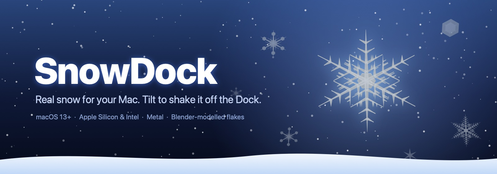
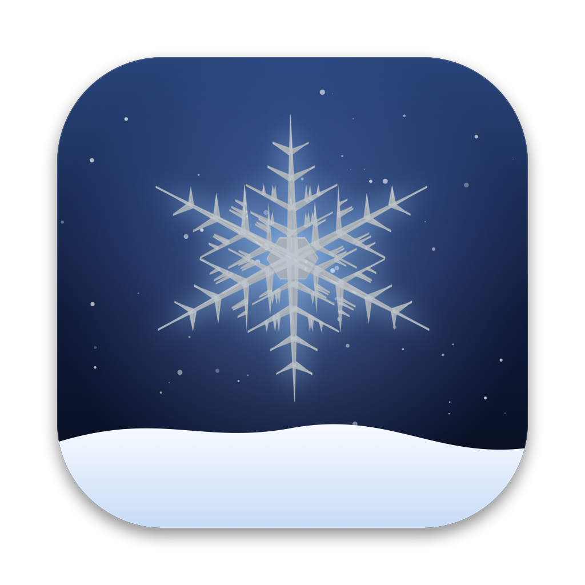

<p align="center">
  
</p>

<p align="center">
  <a href="https://github.com/Asta39/snowdock/releases/latest"></a>
  
  
  
</p>

<p align="center">
  
</p>

**SnowDock** lets it snow on your Mac desktop. Ice crystals modelled in Blender drift down over your windows, settle on the Dock and slowly melt. On Apple Silicon MacBooks you can **tilt the laptop to slide the snow off the Dock** or knock it to shake the snow loose. The motion comes from the Mac's built-in accelerometer.

## Install

**One line (recommended):** paste into Terminal:

```bash
curl -fsSL https://raw.githubusercontent.com/Asta39/snowdock/main/install.sh | bash
```

This downloads the latest release, copies SnowDock to `/Applications` and opens it. You won't see any "unidentified developer" warnings.

**Or download the DMG:**

1. Grab `SnowDock.dmg` from [Releases](https://github.com/Asta39/snowdock/releases/latest).
2. Open it and drag **SnowDock** onto **Applications**. Drag it yourself rather than letting a "move to Applications" helper do it.
3. The first time you open it, macOS blocks it because SnowDock isn't notarized yet. Go to **System Settings → Privacy & Security**, scroll down and click **Open Anyway**, then confirm.

When SnowDock asks for **Accessibility** access, allow it. It only uses this to measure the Dock so the snow lands in the right place.

## Features

| | |
|---|---|
| ❄️ **Real crystals** | Dendrites, stellar plates, sectored and hex plates, modelled as 3D meshes in Blender and rendered as translucent ice |
| 🏔 **Snow that piles up** | Flakes settle on the Dock, build into drifts, melt over time and spill off the ends |
| 📐 **Tilt physics** | Tilt your MacBook and the drift slides downhill and pours off the edge |
| 💥 **Shake** | Knock the laptop and the snow flies up |
| 🌌 **Depth** | Far flakes are soft and slow, near flakes are sharp and tumble as they fall |
| ⚡️ **Light** | Drawn with Metal, using about 5% of one CPU core |
| 🖱 **Click-through** | Never gets in the way of your mouse or windows |

The ❄︎ menu bar item has **Calibrate flat**, **Cycle tilt axis**, **Invert tilt**, **Shake now**, **Dump snow on Dock**, **Toggle HUD** and **Quit**.

## Requirements

- macOS 13 Ventura or later
- Any Mac, Apple Silicon or Intel
- Tilt and shake need an Apple Silicon MacBook (tested on a MacBook Air M2). Other Macs can use **❄︎ → Shake now**.
- The Dock must be at the bottom of the screen

## Build from source

```bash
git clone https://github.com/Asta39/snowdock.git && cd snowdock
./build-dmg.sh                       # → build/SnowDock.app + build/SnowDock.dmg (universal)
open build/SnowDock.app
```

To make a signed and notarized build (needs an Apple Developer account):

```bash
SIGN_ID="Developer ID Application: Your Name (TEAMID)" NOTARY_PROFILE=snowdock ./build-dmg.sh
```

### Project layout

```
Sources/SnowDock.swift     app: overlay window, Metal renderer, snow + pile physics, motion sensor
Resources/flakes/          Blender-rendered crystal sprites (bundled into the app)
blender/make_flakes.py     procedural crystal generator (Blender, headless)
blender/flakes.blend       the crystal models, for hand editing
tools/make_icon.swift      builds the app icon and README banner from a rendered flake
tools/probe.swift          lists your Mac's motion sensors and prints live readings
packaging/                 Info.plist, AppIcon.icns
build-dmg.sh               builds the universal .app and .dmg, with optional signing and notarization
install.sh                 one-line installer
```

## Snowflakes (Blender)

`blender/make_flakes.py` builds six-sided crystals in four styles: dendrites, stellar plates, sectored plates and hex plates. It shades them as translucent ice with a refractive index of 1.31 and a glossy coating, and renders them top-down with Cycles onto transparent backgrounds. Regenerating them takes about 40 seconds on an M2:

```bash
/Applications/Blender.app/Contents/MacOS/Blender -b -P blender/make_flakes.py -- \
  --out Resources/flakes --count 8 --size 256 --samples 64
```

To rebuild the icon and banner from a rendered flake:

```bash
swift tools/make_icon.swift Resources/flakes/flake_0.png build/art
```

## How tilt works

Apple Silicon MacBooks have an accelerometer and gyro behind the Sensor Processing Unit (SPU), but macOS doesn't make them available to apps. SnowDock:

1. turns the sensors on by setting reporting properties on `AppleSPUHIDDriver` through IOKit, which doesn't need admin rights
2. reads accelerometer readings over HID about 200 times a second
3. smooths them to find which way gravity points, and feeds the sideways part into a sand-pile simulation on the Dock
4. treats sudden jolts as a shake

This uses undocumented hardware access. It works today, but a macOS update could break it, and it keeps the app off the Mac App Store.

To see the sensors on your own Mac:

```bash
swiftc -O tools/probe.swift -o probe && ./probe
```

## FAQ

**Why does macOS say SnowDock can't be opened?**
Every app downloaded outside the App Store needs Apple notarization, which costs $99 a year, before it opens without a warning. Until SnowDock has it, use the one-line installer or **Open Anyway** in Privacy & Security.

**I got a "Could not install" message.**
The automatic install from the disk image failed. Drag SnowDock from the open DMG window onto the Applications folder yourself, or use the one-line installer.

**How do I uninstall it?**
Quit it from ❄︎ and drag `/Applications/SnowDock.app` to the Trash.

## Roadmap

- [ ] Notarized builds
- [ ] Snow on window title bars
- [ ] Settings panel (density, wind, melt speed)
- [ ] GPU simulation with 50k+ flakes and real depth-of-field blur
- [ ] Lid-angle fallback for Macs without an accelerometer
